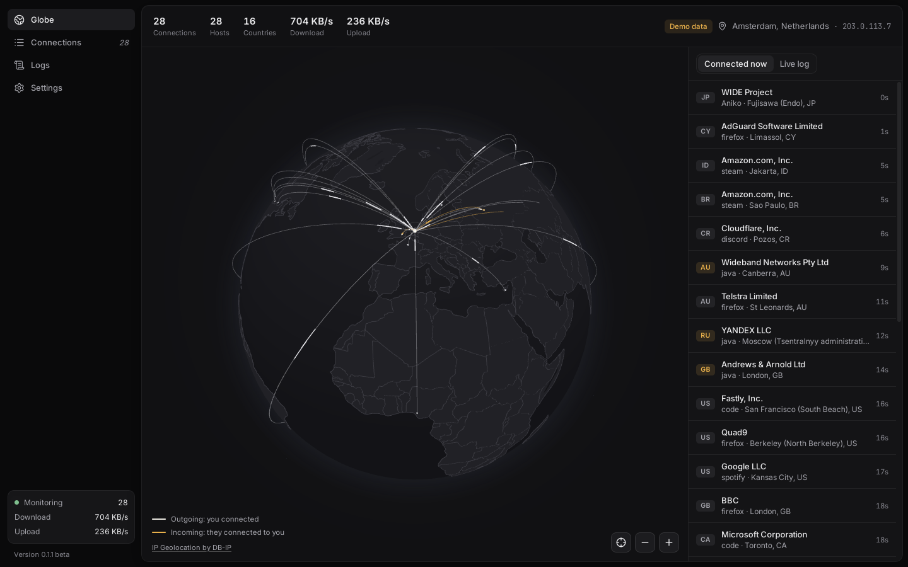
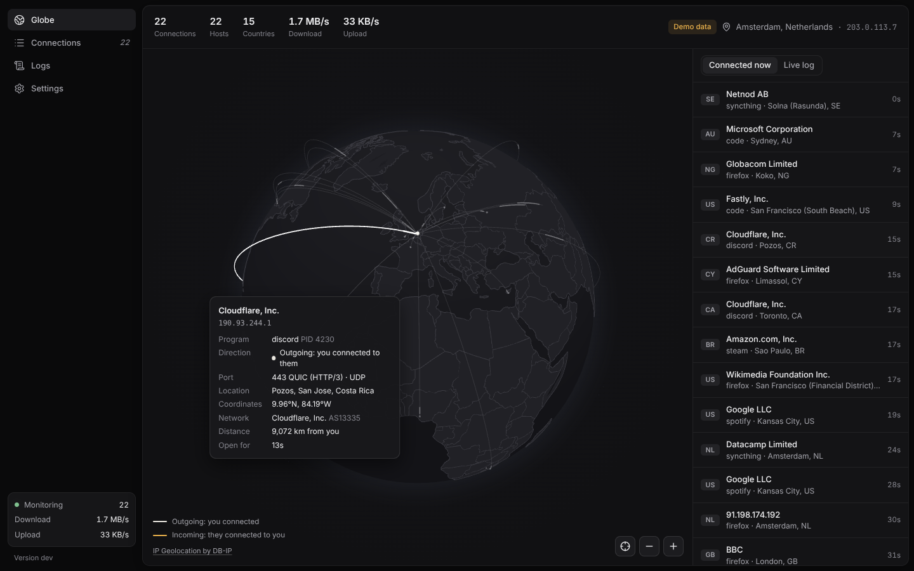

<p align="center"></p>

<h1 align="center">Network Monitor</h1>

<p align="center">Every connection your computer makes, live on a globe: which program, who it's talking to and where they are. For Arch Linux, Windows and macOS.</p>



## What it does

- **A live globe.** A line runs from every address your computer is connected to, to where you are. A light travels along it in the direction the connection was opened: white for connections you made, amber for ones others made to you (a server you run, a game you host).
- **Hover a line (or its dot)** to see who it is: the host name, the network that owns the address (Google LLC, Cloudflare, your ISP…) and its AS number, the city, region and country, coordinates, time zone and distance from you, the program on your computer that holds the connection (and its PID), the ports and service, and how long it's been open. Click to pick it and fly there.

  

- **Connected now:** the hosts you're connected to, newest first, with the details a click away.
- **Connections:** every open connection in a table you can sort and filter (program, address, country, network, port, direction), and **Open ports**: what this computer offers to others, by which program and whether it's reachable from other computers or only this one.
- **Logs:** every connection opened and closed (with how long it was open), every port opened and closed, your public address changing (a VPN connecting), kept one file per day for as long as you choose. Search them, filter by kind, and export a day as CSV.
- **Traffic:** download and upload speed of the whole computer.
- **Updates itself** from this repository's releases, with a beta channel (below).

One program, one window: nothing runs in the background, nothing listens on a port, and closing the window stops it.

## Privacy

- Addresses are placed on the map **offline**, from [DB-IP](https://db-ip.com)'s free Lite databases (City and ASN, CC BY 4.0). They're downloaded on the first start (about 75 MB) and refreshed once a month. No address you connect to is sent anywhere to be looked up.
- To place **you**, the app asks a public service (ipify; if it doesn't answer, checkip.amazonaws.com, icanhazip.com or ifconfig.me) for your public address once every 10 minutes, and looks that up offline too. You can set your location by hand in Settings instead; then nothing is asked.
- Host names come from your own DNS server (reverse DNS), the same as `netstat` without `-n`. It can be turned off.
- The log stays on your computer.

## Install

Download the newest release from the [Releases page](https://github.com/v0-0x/Network-monitor/releases).

**Arch Linux:** the package, or build it from source:

```bash
sudo pacman -S --needed git base-devel go npm webkit2gtk-4.1
```

```bash
git clone https://github.com/v0-0x/Network-monitor ~/Network-monitor
```

```bash
cd ~/Network-monitor/packaging/arch && makepkg -sif
```

Update a source install with:

```bash
cd ~/Network-monitor && git pull && cd packaging/arch && makepkg -sif
```

**Windows 10 and 11:** `NetworkMonitor-Setup-<version>-windows-x64.exe` installs it for you (no administrator rights needed), or run `NetworkMonitor-<version>-windows-x64.exe` as it is. It isn't signed, so SmartScreen may ask the first time: *More info › Run anyway*.

**macOS 12 and newer** (Apple silicon and Intel): open the `.dmg` and drag Network Monitor to Applications. It isn't signed by Apple, so the first time right-click it and choose **Open** (or run `xattr -dr com.apple.quarantine "/Applications/Network Monitor.app"`).

## Updates

Settings › Updates checks this repository's releases at start and every 6 hours, downloads the file for your system, checks it against the release's `SHA256SUMS.txt` and installs it:

| System | How |
|---|---|
| Arch Linux | `pacman -U` on the release's package, through `pkexec` (your desktop asks for your password). Without a password dialog it shows the `sudo pacman -U …` command. A copy built from source in another way updates with `git pull` |
| Windows | the new `.exe` takes the place of the running one, and the app starts again |
| macOS | the new app takes the place of the old one in Applications, and opens |

**Beta and stable.** Every push to `main` is released as a beta (a GitHub pre-release). A beta becomes stable when it's promoted: run the *Build and release* workflow by hand with channel `stable`, or push a commit whose title has `[stable]` in it. Turn on **Beta updates** to get betas; a beta build has it on until you turn it off.

## How it reads connections

No packet capture and no administrator rights: the app reads the system's own connection tables once a second (adjustable), like `ss`, `netstat` and `lsof`.

| System | Source |
|---|---|
| Linux | `/proc/net/tcp`, `tcp6`, `udp`, `udp6`, with each socket's process from `/proc/<pid>/fd` |
| macOS | the kernel's socket lists (`net.inet.tcp.pcblist_n`, `net.inet.udp.pcblist_n`, as `netstat` reads them), falling back to `lsof` |
| Windows | `GetExtendedTcpTable` and `GetExtendedUdpTable` |

What that means:

- A connection that opens and closes between two reads (well under a second) can be missed.
- Without administrator rights, connections of other users' programs (on Linux: root's, such as `sshd`) are listed without a program name.
- Windows doesn't say where UDP traffic goes, so QUIC (HTTP/3) connections only show on Linux and macOS.
- Locations are where the address is registered, which for big services (Google, Cloudflare) is a data centre near you, not the company's head office.

## Build

```bash
make            # build/bin/network-monitor (Linux: needs webkit2gtk-4.1)
make test       # the Go tests
make demo       # run it with made-up connections, to try the globe
make arch       # build and install the Arch package
```

It's a [Wails](https://wails.io) app: Go reads the connections, finds where they are and keeps the log (`internal/`), and the page in `frontend/` (React, TypeScript and [globe.gl](https://github.com/vasturiano/globe.gl)) draws them in the system's own web view (WebKitGTK, WebView2, WKWebView). `wails dev` runs it with live reload. The release builds for all three systems are in `.github/workflows/release.yml`.

## Credits

IP geolocation by [DB-IP](https://db-ip.com) (CC BY 4.0). Country shapes from [Natural Earth](https://www.naturalearthdata.com) via [world-atlas](https://github.com/topojson/world-atlas). Globe by [globe.gl](https://github.com/vasturiano/globe.gl).

## License

GPL-3.0-or-later.
